<p align="center">
  <picture>
    <source media="(prefers-color-scheme: dark)" srcset="assets/readme/wordmark-dark.svg">
    
  </picture>
</p>

<p align="center">
  <a href="README.md">README</a> ·
  <a href="https://nymira.pages.dev">Website</a> ·
  <a href="https://nymira.pages.dev/#docs">Documentation</a> ·
  <a href="THREAT_MODEL.md">Threat model</a> ·
  <a href="https://github.com/nymiralabs/nymira/releases">Releases</a>
</p>

# Try Nymira in 20 minutes

Nymira is private, prepaid API credits on NEAR. You put test USDC into a note, spend it on an attested model without an account, and take the rest back. This guide takes you from nothing to a first answer and a close. Everything runs on NEAR testnet with Circle's test USDC, which has no value. Read [the README](README.md) and [THREAT_MODEL.md](THREAT_MODEL.md) for what is and is not protected.

## What is live

| What | Where |
|---|---|
| Web app | <https://nymira.pages.dev> (the copy at <https://nymiralabs.github.io/nymira/> is only for `nymirad verify-web`; the app does not run there) |
| Vault | `vault.nymira.testnet` |
| Token | Circle's testnet USDC, account `3e2210e1184b45b64c8a434c0a7e7b23cc04ea7eb7a6c3c32520d03d4afcb8af` |
| Operator status | <https://nymira-operator.tail0484c4.ts.net/v1/status> |
| Explorer | <https://testnet.nearblocks.io> |
| `nymirad` releases | <https://github.com/nymiralabs/nymira/releases> |

The operator runs on a home machine. If the status link does not answer, it is offline; wait or try later. The deployment table in the README lists code hashes and keys you can check against the chain.

## Path 1: the web app

You need a desktop browser and about 20 minutes.

1. **Get a wallet account.** Open <https://nymira.pages.dev>, press Open web app, then Connect wallet in the top bar, and connect Meteor or Intear Wallet on testnet. Meteor works on testnet. Intear signs in, but its approval window can fail to report back; the app then reads the vault to see whether the transaction landed. You need a little test NEAR for gas.
2. **Get test USDC.** Go to <https://faucet.circle.com>, choose Near Testnet, and ask for USDC for your account. A request gives 20 USDC, and each address can ask once every 2 hours.
3. **Register with the token.** The USDC contract only accepts an account that has paid for its storage. Register your account once (0.00125 NEAR), here with [near-cli-rs](https://github.com/near/near-cli-rs):
   ```bash
   near contract call-function as-transaction 3e2210e1184b45b64c8a434c0a7e7b23cc04ea7eb7a6c3c32520d03d4afcb8af storage_deposit json-args '{"account_id":"YOUR.testnet","registration_only":true}' prepaid-gas '30 Tgas' attached-deposit '0.00125 NEAR' sign-as YOUR.testnet network-config testnet
   ```
   If you pay out to a different account, register that one the same way.
4. **Fund a note.** On the Fund screen pick the 1 USDC note. The app shows the price: the note plus a 0.05 USDC fee that you do not get back. On first open the app asks for an unlock passphrase (or a passkey): it opens the note secret on this device. At the backup step type a separate file passphrase twice, or switch on "Use my unlock passphrase for the file", then download the encrypted backup and send. The app reads the `deposit` event from your transaction, shows the note ID and offers an explorer link. Open it and check that the payout account is yours.
5. **Wait a little.** The operator adds your note to the vault's tree on its next root update. If Chat says the note is not in the tree yet, wait and try again. A chat right after funding is also easier to link to the deposit by timing.
6. **Chat.** Open Chat, press Chat with this note on your note, pick a model and ask something. The first step loads a proving key (about 5 MB) and checks its hash; a note picked in the sidebar shows "Opening note" until that is done, then the conversation opens on it. Under the answer you see a badge:
   - `model-signed response`: the model's TEE signed the answer, and the signature checked out.
   - `gateway-signed response`: the gateway signed it, not the model.
   - `not verified`: the signature could not be checked. Treat the answer as unauthenticated.
7. **Close.** Open Close. Keep Close with the operator (the other choice, Exit without the operator, takes 7 days), press Close note and sign with your wallet; there is no close fee from your wallet. The vault pays the rest to the payout account. The close shows your note ID, the total you spent and the payout account on chain. Check the payout in the explorer.

Test models available: `z-ai/glm-5.3-flash` (default), `Qwen/Qwen3.6-35B-A3B-FP8`, `Qwen/Qwen3.8-27B`, `Qwen/Qwen3-VL-30B-A3B-Instruct`.

### Also worth a look in the web app

- **[Documentation](https://nymira.pages.dev/#docs)**: how a note lives, who sees what, the vault, and a lease calculator. It reads one section at a time and has a search.
- **[Status](https://nymira.pages.dev/#status)**: reads the operator, the vault against the pins in the bundle, each RPC endpoint and the release manifest when you press Check. Each read shows your address to that host.
- **[Notes](https://nymira.pages.dev/#notes)**: your notes with their days, the encrypted backup, and a restore. **Privacy panel**, opened from a note in Chat: the set size now, what joins a lease to a note, and what to watch.
- **[Agents](https://nymira.pages.dev/#agents)**: builds and signs a spending policy for an agent with your wallet and prints the `nymirad` commands. It creates no note and sends nothing to `nymirad`. The full guide, with the IronClaw and Cursor recipes, is [BUDGET_NOTES.md](BUDGET_NOTES.md).

## Path 2: `nymirad`, the command line client

`nymirad` sends everything over Tor, which the web app cannot do. Allow another 30 minutes; the setup is longer. It runs on macOS arm64 and Linux x86_64 only.

1. Download `nymirad` from the latest release and check the signature and hashes as in [the README](README.md#download-nymirad).
2. Download `request.pk` and `withdrawal.pk` from the `final` release of [nymira-ceremony](https://github.com/nymiralabs/nymira-ceremony) into one directory. `nymirad` refuses files whose hash differs from the one built into it.
3. Provide Tor. On a Mac with Apple silicon, follow the README: Homebrew's `tor` 0.4.9.15, or your own Tor with `--socks 127.0.0.1:9050`. Release 0.1.4 pins Homebrew's `tor` for macOS and Debian 12's `tor` 0.4.9.11-0+deb12u1 for Linux amd64 and arm64 (see the README). Other Linux distributions run their own Tor and use `--socks`.
4. Set up the state directory:
   ```bash
   nymirad init --rpc https://rpc.testnet.fastnear.com --operator https://nymira-operator.tail0484c4.ts.net --account YOUR.testnet --setup-dir DIR_WITH_THE_TWO_KEYS --local-only
   ```
   Add `--socks 127.0.0.1:9050` if you run your own Tor. `--local-only` keeps the encrypted backup on this machine; use `--place DIR` for a second copy.
5. Put the 32-byte ed25519 seed, as hex, of a funded testnet account in a file with mode 0600. (NEAR tools write secret keys as `ed25519:` plus base58 of 64 bytes; the seed is the first 32.) Register that account with the USDC token as in step 3 of Path 1. Then `nymirad status` should show the operator and "Vault: matches the pins", and:
   ```bash
   nymirad deposit --key-file FILE --amount 1000000
   ```
   `1000000` is 1 USDC in base units. It prints the amount and payout account and asks you to type `yes`.
6. Start the local gateway with `nymirad serve`. It listens on `127.0.0.1:8788` and keeps an owner token in `~/.nymira/owner.token`. Any OpenAI-style client on your machine can use it:
   ```bash
   curl http://127.0.0.1:8788/v1/chat/completions -H "Authorization: Bearer $(cat ~/.nymira/owner.token)" -H 'content-type: application/json' -d '{"model":"z-ai/glm-5.3-flash","messages":[{"role":"user","content":"Say hello."}]}'
   ```
7. `nymirad status` lists the last leases with the signature verdict. Close with `nymirad close --note ID`; it waits a random time before it asks the operator to clear the close, so allow a while. Without a submitter account (`nymirad submitter add`), add `--via-operator`: the operator then pays the gas and keeps the close fee.

## Path 3: try it with no keys and no money

If the live deployment is down, or you only want to see the flow, run the local stack from a clone. It needs the pinned Rust toolchain and cargo-near 0.22.0:

```bash
make golden   # deposit, chat, settlement, close and retirement, asserted step by step
make demo     # keeps the stack up and prints the nymirad commands to run against it
```

The stack is a sandbox vault with a mock token and a fake NEAR AI gateway, so nothing in it is real.

## What to expect

- A deposit shows a 0.05 USDC note fee. A close costs 0.03 USDC when the operator submits it. Both are test USDC, not revenue.
- A chat costs a fraction of a cent. The lease takes a bound of 0.10 USDC (or 0.50 USDC for a long job) from your note and returns what the model did not use.
- Prompts are encrypted to the model's attested key. The operator's entry relay sees your IP address and request times, unless you use `nymirad` over Tor. The operator sees request times, sizes and the model name, not the text. The model reads your prompt.
- The operator has a small daily provider budget (`daily_budget` in `/v1/status`, which resets at UTC midnight). When it is used up, chat answers 429 `operator_capacity` until then.
- The testnet anonymity set is small and made of test notes. A lease is easier to tie to a note than it would be on a busy network.

## Known limits

- **Chat can be refused after a NEAR AI redeploy.** The clients check the model's and the gateway's attestation against a signed policy that lists the deployments we reviewed. When NEAR AI redeploys, the policy is stale until we sign a new one and release it. Chat then fails, in `nymirad` with `provenance.verification_failed`. A newer `attestation-policy.json` from a release fixes it for `nymirad`. The web app picks up a newer signed policy that the site serves beside the release, so a redeploy does not need a new web release; a policy the signer key did not sign is ignored. Since version 5 the policy accepts any compose hash for the gateway (its measurements, TCB status and signing key are still checked), because that deployment changes often; the model deployment keeps exact compose hashes.
- **NVIDIA's GPU check over Tor.** NVIDIA's attestation service (NRAS) answers 403 to Tor exit nodes ([issue 165](https://github.com/nymiralabs/nymira/issues/165)), so `nymirad` cannot send the model's GPU evidence there over Tor. The operator relays it: the operator forwards the evidence to NVIDIA and returns the answer unchanged, and your client checks the verdict itself: the signature, the nonce, the times, and a certificate chain that reaches a certificate pinned in the signed attestation policy. A relay that forges a verdict fails that check; one that refuses can only block the chat. The operator learns that some client asked for a GPU check, and when. It keeps nothing.
- The signed policy pins two NVIDIA intermediate certificates taken from NVIDIA's public key set on 5 November 2026. On 5 November 2026 the 005 certificate matched the copy served by NVIDIA's own PKI host and both verify under the root published there, but no NVIDIA documentation page lists the fingerprints, so the policy marks them unverified, and the NVIDIA root is not pinned. One chat over Tor with the relay passed this check on 5 November 2026.
- With `nymirad serve --nras-direct` the evidence goes straight to NVIDIA and NVIDIA sees your IP address. It is off by default, `nymirad status` says when it is on, and `nymirad` never switches to it by itself.
- The web app does not check NVIDIA GPU evidence. It checks the Intel TDX quote, the policy and the key binding, and says so.
- **The web app cannot use Tor.** The operator's entry relay and the RPC provider see your IP address.
- **Test funds only.** The circuit has had no independent review. The keys come from a setup run by the team alone, so the team could forge proofs if the setup was not sound. The team's full-access key can replace the vault code. Open deposits are capped at 100 USDC.
- **Keep your backup.** If you lose your latest state, an exit from an older state can be defeated and you can lose the remaining balance.
- **The operator can be offline.** If it is, you can leave with `request_exit` after the 7-day window, which needs no operator.

## Check what we claim

- Vault code hash, `vk_hashes()` and the access keys: the table in [the README](README.md#live-deployment).
- Web bundle and `nymirad` signatures: `web/INTEGRITY.md` and the README's download section. The release key is `web/pins/release-signing.pub`.
- Terms of use: [TERMS.md](TERMS.md), or `nymirad terms`.
