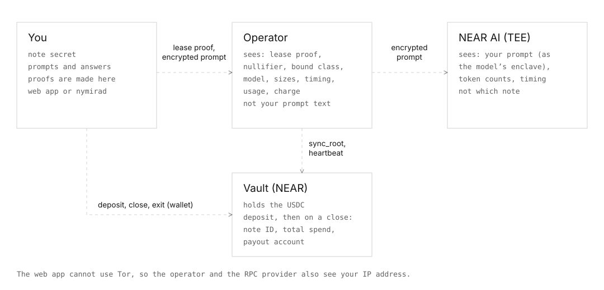
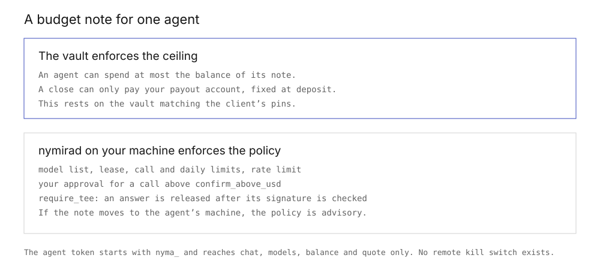

<p align="center">
  <picture>
    <source media="(prefers-color-scheme: dark)" srcset="assets/readme/hero-dark.svg">
    
  </picture>
</p>

<p align="center">
  <a href="https://nymira.pages.dev">Website</a> ·
  <a href="https://nymira.pages.dev/#docs">Documentation</a> ·
  <a href="https://nymira.pages.dev/#status">Status</a> ·
  <a href="JUDGES.md">Try it in 20 minutes</a> ·
  <a href="THREAT_MODEL.md">Threat model</a> ·
  <a href="https://github.com/nymiralabs/nymira/releases">Releases</a> ·
  <a href="TERMS.md">Terms</a>
</p>

<p align="center">
  <a href="https://github.com/nymiralabs/nymira/actions/workflows/ci.yml"></a>
</p>

# Nymira

**This is a testnet project with test funds.** The vault holds Circle's testnet USDC, which has no value. The circuit has had no independent review, and zkapi does not use it on its own mainnet yet. The anonymity set on testnet is small and made of test notes, so a lease can be tied to a note more easily than it could be on a busy network. Read [THREAT_MODEL.md](THREAT_MODEL.md) before you trust any sentence here. Use of the deployment is under the [terms of use](TERMS.md).

Want to try it? [JUDGES.md](JUDGES.md) is a 20-minute path from a new wallet to a first answer and a close. The same material, with diagrams and a lease calculator, is on the [documentation page](https://nymira.pages.dev/#docs).

**Contents:** [What Nymira is](#what-nymira-is) · [Quickstart](#quickstart) · [Status](#status) · [For hackathon judges](#for-hackathon-judges) · [Live deployment](#live-deployment) · [Limits](#limits) · [Download `nymirad`](#download-nymirad) · [Build](#build) · [Budget notes for agents](#budget-notes-for-agents) · [Documentation](#documentation) · [License](#license)

## What Nymira is

A pay-as-you-go API usually ties every request to an account and a card, so the provider can read your whole history, and a model key given to an agent can drain the account behind it. Prepaying removes the card from the request path. A zero-knowledge proof removes the account too. A budget note caps what one agent can ever spend.

Nymira sells prepaid API credits. You deposit USDC into a vault contract on NEAR and get a note: a balance only you can spend. Each conversation spends a short lease from the note. Your device proves that the note can pay without saying which note it is, and your prompt is encrypted to the model's attested key, so the operator does not read it. When you are done, you close the note and the rest goes to a payout account that was fixed at deposit. Without the operator, you leave with `request_exit` and a 7-day wait ([how an exit works](https://nymira.pages.dev/#docs/note-life)).

<p align="center">
  <picture>
    <source media="(prefers-color-scheme: dark)" srcset="assets/readme/parties-dark.svg">
    
  </picture>
</p>

<p align="center">
  <picture>
    <source media="(prefers-color-scheme: dark)" srcset="assets/readme/lease-dark.svg">
    
  </picture>
</p>

## Quickstart

A local stack needs no keys and no money. On a fresh clone:

```bash
git clone https://github.com/nymiralabs/nymira && cd nymira
rustup show                                           # installs the pinned toolchain (rust-toolchain.toml)
cargo install cargo-near --version 0.22.0 --locked    # the sandbox tests need it
make golden    # a note is deposited, used, settled, closed and retired, asserted step by step
make demo      # the stack stays up and prints the `nymirad` commands to try against it
```

To use the live testnet deployment instead, open <https://nymira.pages.dev> and follow [JUDGES.md](JUDGES.md). [Try it locally](#try-it-locally) says what each command starts.

## What we built on top of zkapi

The proof circuits and the off-chain wallet logic come from [zkapi](https://github.com/ethereum/zkapi), pinned at one commit with eight listed patches (`NOTICE`). The rest is ours, written during the hackathon:

- **The vault**, a NEAR contract in `near-sdk` that holds USDC, keeps the commitment tree and the spent nullifiers, and runs close, exit and expiry. Its Groth16 verifier (`crates/nymira-verifier`) runs on NEAR's `alt_bn128` host functions, and the verifying-key hashes are compiled into the contract.
- **The NEAR mapping** of zkapi's EVM fields (`crates/nymira-near-codec`), shared by the contract, the operator, `nymirad` and the browser.
- **The operator**, which opens a lease from a proof and settles the charge, and calls [NEAR AI Cloud](https://cloud.near.ai) with a key made for one lease.
- **Private inference.** Prompts are encrypted to the model's attested key. Clients check the Intel TDX quote, a signed policy and, in `nymirad`, NVIDIA GPU evidence.
- **Clients:** the web app, and `nymirad`, a local gateway that sends through Tor and speaks the OpenAI API, so existing tools work unchanged.
- **Budget notes and an MCP server** for agents, with a signed spending policy.
- **Funding from other chains** through [NEAR Intents](https://near-intents.org) (1Click).
- **Our own trusted-setup ceremony**, so the deployed keys are not zkapi's development keys.

## Status

| Part | State |
|---|---|
| Web app | Release 0.1.6 is live at <https://nymira.pages.dev>. It follows 0.1.5 (a pool of free public RPC endpoints) with several messages in one conversation (the second message was sometimes refused), notes that are closing or exiting leading to the Close screen, a backup "Save" that leads to the backup form, and a chat answer limit counted the way the operator counts it. |
| `nymirad` | Release [0.1.4](https://github.com/nymiralabs/nymira/releases/tag/nymirad-v0.1.4) has Linux x86_64 and macOS arm64 binaries with signed checksums ([how to download and check them](#download-nymirad)). It carries attestation policy version 6. Budget notes (`nymirad agent`), the set size option (`--rpc-second`) and the Debian Tor pins came with 0.1.3. |
| Vault | [`vault.nymira.testnet`](https://testnet.nearblocks.io/address/vault.nymira.testnet) on NEAR testnet, built reproducibly from the tag [`vault-testnet-1`](https://github.com/nymiralabs/nymira/tree/vault-testnet-1) ([values and checks](#live-deployment)). |
| MCP server | Not released. Build it from a checkout of [`mcp/`](mcp/README.md). |
| Paying sellers (x402) | Not built. |
| Mainnet | None. No mainnet vault is pinned in this build. |

## For hackathon judges

1. **Run it.** [JUDGES.md](JUDGES.md) takes you from a new wallet to a first answer and a close in about 20 minutes. A local stack with no keys and no money runs with `make golden` or `make demo`.
2. **Check the chain.** The deployed vault code hash equals the reproducible build, and the on-chain verifying-key hashes equal the ceremony's. The table under [Live deployment](#live-deployment) has the values and how they were checked.
3. **Check the release.** The web release 0.1.6 and the `nymirad` downloads are signed with a key whose fingerprint is published. [`web/INTEGRITY.md`](web/INTEGRITY.md) lists the steps, and `nymirad verify-web` runs them for you.
4. **Read what we do not promise.** [THREAT_MODEL.md](THREAT_MODEL.md) says what each party can see and do, and the [Limits](#limits) below list what is open: no independent review of the circuits or the vault, a trusted setup run by the team alone, a small anonymity set, and an operator on a home machine that can be offline.
5. **Find the code.** [`contracts/vault`](contracts/vault) is the contract. [`crates/nymira-operator`](crates/nymira-operator) is the operator, [`crates/nymirad`](crates/nymirad) the local gateway and CLI, [`web`](web) the browser app, [`mcp`](mcp) the MCP server, and [`vendor/zkapi`](vendor/zkapi) the proof circuits at a pinned commit.


## Live deployment

The vault runs on NEAR testnet with Circle's test USDC (token account [`3e2210e1184b45b64c8a434c0a7e7b23cc04ea7eb7a6c3c32520d03d4afcb8af`](https://testnet.nearblocks.io/address/3e2210e1184b45b64c8a434c0a7e7b23cc04ea7eb7a6c3c32520d03d4afcb8af)). Every value below can be checked against the chain.

<p align="center">
  <picture>
    <source media="(prefers-color-scheme: dark)" srcset="assets/readme/money-dark.svg">
    
  </picture>
</p>

- **Vault account.** [`vault.nymira.testnet`](https://testnet.nearblocks.io/address/vault.nymira.testnet), deployed in transaction [`G1LGwd1oxcrza7VSwNuGYf9xjaMeNJzYdEZ2EFamjQVY`](https://testnet.nearblocks.io/txns/G1LGwd1oxcrza7VSwNuGYf9xjaMeNJzYdEZ2EFamjQVY) (`new()` ran in the same transaction)
- **Vault code hash (reproducible build).** `71QXP9FT4eiRcaqjZtsHi7mXMCAexXjCFgQ338p8tur4` in base58; as SHA-256 of the wasm, `5940b853e51476c69ab2cd0ffba2fb76ffd3fedb621a2471c9ccd2bdb62ad4f5`. Built from the tag [`vault-testnet-1`](https://github.com/nymiralabs/nymira/tree/vault-testnet-1) (commit [`18107d8`](https://github.com/nymiralabs/nymira/commit/18107d876dd9d3912796f4b002e9a006c74b1152)) with [`scripts/reproducible-smoke.sh`](scripts/reproducible-smoke.sh) (cargo-near 0.22.0, rustc 1.99.0, image `sourcescan/cargo-near@sha256:51ab40efd798eae26c0dc71180909303f10bb4988b15ce3a18522c5be06e277e`). The on-chain hash was checked against the build with `view_account`, and testnet.nearblocks.io shows the contract as source code verified (<https://testnet.nearblocks.io/address/vault.nymira.testnet/contract/code>). Two builds on one Mac (arm64) were equal, and a build on an amd64 CI runner ([`vault-reproducible`](.github/workflows/vault-reproducible.yml) workflow, 5 November 2026) gave the same hash.
- **`vk_hashes()` next to the ceremony transcript hashes.** On chain: request `0xf3092e0d550f696a6507f279862afb43d0c22663de56f1b47160b5db6fc6fa1b`, withdrawal `0x3469ebb3245101549343dbe5939427d3dc7706c314f281f9b5935416fc720c8d`. These equal the verifying key keccak256 values in the `final` release of [nymira-ceremony](https://github.com/nymiralabs/nymira-ceremony), whose transcript SHA-256 is `e75cae40c203b08f8b9e559a2fa4b18f464e709d68abe01318c2d8a7aa4b7e07` (beacon: NEAR mainnet block 222942364). Proving key SHA-256: `request.pk` `b5cdb12000cf51cf566375aadbc2a27cf875438f646f751fa857371cd6cb7022`, `withdrawal.pk` `89e03ac8f9d6e90d189e9a3eb6b0c9c0126e1b121e78955a11f0f70a44d0161d`.
- **`view_access_key_list` of the vault.** One key, full access: `ed25519:DJc2C6WWveyUY1VvLEdUPjBggzKrMuEwx7GGp1BLHMze`. It is the team's, and it can replace the vault code (see [THREAT_MODEL.md](THREAT_MODEL.md)).
- **Vault config (`config()`).** Operator [`operator.nymira.testnet`](https://testnet.nearblocks.io/address/operator.nymira.testnet), owner [`owner.nymira.testnet`](https://testnet.nearblocks.io/address/owner.nymira.testnet), treasury [`treasury.nymira.testnet`](https://testnet.nearblocks.io/address/treasury.nymira.testnet). Denominations 1 and 5 USDC, bound classes 0.10 and 0.50 USDC, charge step 0.001, minimum charge 0.002, deposit fee 0.05 USDC, close fee 0.03 USDC, exit delay 604800 s (7 days), note TTL 2592000 s (30 days), cap on open deposits 100 USDC.
- **Web bundle.** Release testnet 0.1.6 (tag [`web-v0.1.6`](https://github.com/nymiralabs/nymira/tree/web-v0.1.6)), served at <https://nymira.pages.dev>. A static copy at <https://nymiralabs.github.io/nymira/> holds the same files, so `nymirad verify-web` can compare two hosts. The app does not run from that copy: it cannot send the security headers, and its files are requested from the root of the host. `bundle_hash` `3c904a27230dfb6cfef005dd373d4890802c220318597e4901380df9e1e89891`, `header_set_hash` `c4035ad9b05d62b3fb6f4cb8fe430249c8875b199a7975242742ca514a4f8cd2` (the same header set as 0.1.5). The signed manifest is in [`web/releases/testnet-0.1.6/`](web/releases/testnet-0.1.6/); the signing key is [`web/pins/release-signing.pub`](web/pins/release-signing.pub) (minisign key id `934C176AF34D794D`). A public Sigstore Rekor entry ([index 3813432556](https://search.sigstore.dev/?logIndex=3813432556)) holds the hash of a text with these two hashes and the key (the entries for 0.1.5, 0.1.4, 0.1.3 and 0.1.2 are [index 3810960925](https://search.sigstore.dev/?logIndex=3810960925), [index 3808318068](https://search.sigstore.dev/?logIndex=3808318068), [index 3796098761](https://search.sigstore.dev/?logIndex=3796098761) and [index 3700443670](https://search.sigstore.dev/?logIndex=3700443670)). See [`web/INTEGRITY.md`](web/INTEGRITY.md). Cloudflare adds `access-control-allow-origin: *` to some pages while the signed header set has none; `nymirad verify-web` prints those as accepted notes. No outside party has rebuilt the bundle and attested to it yet.
- **Keys the vault uses.** The vault account holds only the full-access key above. `operator.nymira.testnet` holds function-call keys limited to `vault.nymira.testnet`: `heartbeat` (`ed25519:ByNe51phL1HLruA2m5mpUNjYU8N8fdAiv2vzjTUPg8Cp`), `mutual_close` (`ed25519:6Sz6SKZd4VRYSiXFANiFS32yNhSfAMwDarHmbmjMiacZ`), and two upkeep keys for `sync_root`, `retire_closed_leaf`, `claim_expired`, `claim_expired_batch` and `finalize_exit` (`ed25519:EcnUgf2F3nVVGh3VJDxydjxfo8asTGJrv2oPaTEns3Di` and, from a second machine, `ed25519:FQZbqfECB8XpMVP42osm5HadqiZpqUyuVzF2cEBmFM7s`). The operator account also carries two old gas keys for `vaultdev.nymira.testnet`, a test vault that is no longer in use, and one full-access key that is kept offline. `owner.nymira.testnet` and `treasury.nymira.testnet` each hold one full-access key. `answer.nymira.testnet` holds the `defeat_exit` and `raise_concession` keys: `ed25519:3aQcKFzVdwHVBM6vjES6LYimcwDZWRwr7V2grAVg1qRC` (laptop) and `ed25519:HBqKTwBSqY62moLVqCK7MM7DZ36hAcQ2jTo2P95J5KbC` (second machine); its full-access key is `ed25519:396S8bP3UUU4zgRLjjYGGP7rEZMi47SzS7T6MKMUnEcf`.
- **Operator status.** <https://nymira-operator.tail0484c4.ts.net/v1/status>, served from a home machine that can be offline.

The proving and verifying keys come from a setup run by the team alone (the log, scripts and the accepted contributions are in [nymira-ceremony](https://github.com/nymiralabs/nymira-ceremony)). They are sound if at least one contributor really was honest, and the team cannot prove that: if every contribution was dishonest or its machine was compromised, proofs can be forged and the vault emptied. zkapi's development keys, whose secrets are public, never run on the final public vault or on mainnet. The deployed vault uses the final ceremony keys (see the table). A deposit fee is read from the vault's `config()`; on testnet it is a placeholder in test USDC and is not revenue.

The proving keys are release assets of the ceremony repository (`request.pk`, `withdrawal.pk`, tag `final`). The web app serves them from its own signed bundle and checks their SHA-256 before use. For `nymirad`, download both files into one directory and pass it once: `nymirad init ... --setup-dir DIR`. For example, `gh release download final -R nymiralabs/nymira-ceremony -p request.pk -p withdrawal.pk -D DIR`, or the same two files from the release page. `shasum -a 256 DIR/request.pk DIR/withdrawal.pk` must print the two proving-key hashes in the table above. `init` refuses files whose hash differs from the one compiled into the binary (so the check also runs without `shasum`), and without the directory chat and close stay off. `nymirad terms` prints the terms of use.

## Limits

<p align="center">
  <picture>
    <source media="(prefers-color-scheme: dark)" srcset="assets/readme/note-life-dark.svg">
    
  </picture>
</p>

These are the rules of the vault contract and of the testnet deployment. The vault's `config()` shows the values. While you keep your latest state, the operator cannot send your money to another account or block your exit: with `request_exit` you leave to your payout account after 7 days, and the operator can deduct at most the bound of the one lease in flight. If you lose your latest wallet state, an exit from an older state can be defeated and you can lose the remaining balance, so keep your encrypted backup. The team can still update the vault code, and open user deposits in the vault are capped at 100 USDC (test USDC on testnet; the cap bounds open deposits, not what the provider is paid).

The first sentence holds while you keep your latest state; see the first point below. The cap is a vault parameter that the owner can change after a 48-hour delay announced by an event.

- An exit from an old state can be defeated: if you lose your latest state, the operator can answer the exit with a later request and keep what it charged, up to the whole remaining balance. Keep a backup.
- A `nymirad` backup is an age file (X25519) written to the places you chose at setup. With a passphrase instead of a key pair, the age key is derived from it with Argon2id (64 MiB of memory, 3 passes, 1 lane), and the passphrase needs at least 12 characters. A restore needs only the private key or the passphrase, so treat either as you would the notes themselves. `nymirad restore-secret` rebuilds one note from its secret alone, and that note can then only be exited, not spent. Keep a second copy on another device.
- A note expires at the end of the UTC day 30 days after the deposit. The treasury can take it only 7 days after the later of that expiry and the last exit activity on the note, and never while an exit is pending; until then an expired note can still exit and finalize.
- If the operator is offline for a whole 7-day exit window, a user can leave with an older, higher balance than the real one. The loss falls on the operator, and the 100 USDC cap on open deposits bounds it.
- Closing shows your note ID, total spend and payout account on chain, next to the account that sends the close.
- The web app cannot use Tor. The operator's entry relay (a Tailscale Funnel) sees your IP address and request times, and passes the address to the operator's machine in a header that the operator software does not read or store. The RPC provider sees your IP address too. Use Tor Browser or `nymirad` for IP protection.
- GPU evidence goes through the operator relay and is checked in your client. NVIDIA's attestation service (NRAS) answers 403 to Tor exit nodes ([issue 165](https://github.com/nymiralabs/nymira/issues/165)), so `nymirad` cannot send the model's GPU evidence there over Tor. The operator forwards it instead and returns the answer unchanged. It learns that some client asked for a GPU check, and when, and keeps nothing. Your client checks the signature, the nonce, the times, and that the signing key's certificate chain reaches a certificate pinned in the signed attestation policy. The call uses its own Tor circuit, apart from your lease.
- The signed policy ([changelog](crates/nymirad/pins/attestation-policy.changelog.md)) pins two NVIDIA intermediate certificates. They come from NVIDIA's public key set, where on 5 November 2026 every key carried a two-certificate chain. On 5 November 2026 the 005 certificate matched, byte for byte, the one served by NVIDIA's own PKI host (`prod.vault.nvidia.com`), and both intermediates verify under NVIDIA's "Attestation Service CA 001" root published there (SHA-256 `CDE269E3…1A1E`). No NVIDIA documentation page lists these fingerprints, so the policy still marks the pins as unverified, and the root is not pinned. One chat through `nymirad` over Tor with the relay passed the GPU check and ended model-signed on 5 November 2026.
- `nymirad serve --nras-direct` sends the GPU evidence straight to NVIDIA, without Tor, so NVIDIA sees your IP address and when you ask. It is off by default, `nymirad status` says when it is on, and `nymirad` never switches to it by itself.
- The web app does not check NVIDIA GPU evidence. It checks the Intel TDX quote, the signed policy and the key binding.
- A compromised host could serve a different web app. `nymirad verify-web` catches that only if you run it and the host does not cloak, so it does not replace trusting the host you load the app from.
- Everything the other parties see is in [THREAT_MODEL.md](THREAT_MODEL.md).

Nymira reuses the zero-knowledge circuits of [zkapi](https://github.com/ethereum/zkapi) (`ethereum/zkapi`), vendored at a pinned commit in `vendor/zkapi/`. `NOTICE` lists the exact commit and every patch we apply. `PINS.md` records the pins and the toolchain.

## Download `nymirad`

Get the binary from the [releases page](https://github.com/nymiralabs/nymira/releases) (the newest is [nymirad-v0.1.4](https://github.com/nymiralabs/nymira/releases/tag/nymirad-v0.1.4)). Each `nymirad-vX.Y.Z` release has the two binaries, `attestation-policy.json` and a signed `SHA256SUMS` (`SHA256SUMS.minisig`, key in [`web/pins/release-signing.pub`](web/pins/release-signing.pub)) that lists every file. The steps are the same on both platforms:

<p align="center">
  <picture>
    <source media="(prefers-color-scheme: dark)" srcset="assets/readme/verify-dark.svg">
    
  </picture>
</p>

```bash
V=0.1.4                      # the release you want
B=https://github.com/nymiralabs/nymira/releases/download/nymirad-v$V
curl -LO $B/SHA256SUMS -LO $B/SHA256SUMS.minisig -LO $B/nymirad-$V-aarch64-macos   # or ...-x86_64-linux
minisign -V -p web/pins/release-signing.pub -m SHA256SUMS      # the signature must verify
shasum -a 256 -c SHA256SUMS --ignore-missing                   # the binary's hash must match
chmod +x nymirad-$V-aarch64-macos && ./nymirad-$V-aarch64-macos init --help
```

[`minisign`](https://jedisct1.github.io/minisign/) is a small signature checker (`brew install minisign`). The key file is in this repository, so check it out or download that one file first. [`web/INTEGRITY.md`](web/INTEGRITY.md) says how the key's fingerprint is published and how to check it. The full list of `nymirad` commands is in [Try it locally](#try-it-locally) and [Budget notes for agents](#budget-notes-for-agents).

- **Linux x86_64** (`nymirad-X.Y.Z-x86_64-linux`): built twice in the pinned container, and published only when the two builds are identical ([`scripts/release-nymirad.sh build`](scripts/release-nymirad.sh)). In a few runs the two builds differed and the cause is not found, so a rebuild may need a second try. No outside party has rebuilt a release yet.
- **macOS arm64** (`nymirad-X.Y.Z-aarch64-macos`): built by the [`nymirad-macos`](.github/workflows/nymirad-macos.yml) workflow and added to the release by hand, then signed with the rest. The signature shows that the project published these exact bytes. It does not show that the binary matches the source, because the macOS toolchain's output is not byte-stable and nobody can rebuild it to the same hash. If that matters to you, build from the tag yourself or use the Linux binary.

`nymirad` starts its own Tor, and it runs only a Tor executable whose SHA-256 is compiled into the build. A build pins one hash per platform. Three packages are pinned, each one run through `nymirad`'s Tor start, which bootstrapped and carried a request over Tor:

- Homebrew's `tor` 0.4.9.15 for macOS arm64: `c0dcd5d18c534d1e7049c5105bfc39189527b33be65b3d064052c213e7404a46`.
- Debian 12 (bookworm) `tor` 0.4.9.11-0+deb12u1 for amd64, file `/usr/bin/tor`: `e4c45e50909991b8bd83aac3177ecea670e67cd9a8a575ff77b2bdb9c6d71df9`.
- The same Debian version for arm64: `3f7e9edb566e32070e8bb34adfbbd8b3d091b9be3e605106f12e70d518bd3db7`.

`arti` is not pinned: no Debian or Ubuntu package exists for it, and it has not run through `nymirad`.

On a Mac with Apple silicon:

1. `brew install tor`, then check `shasum -a 256 "$(brew --prefix tor)/bin/tor"` prints the macOS hash above. Homebrew moves to newer versions; a different version has a different hash and `nymirad` refuses to start it. In that case use option 3.
2. Copy that file to `~/.nymira/tor/package/tor` (or set `tor_package` in `config.json` to its path). Without a pinned Tor package or your own SOCKS proxy, chat and `close` do not start.
3. Or run a Tor you trust yourself and give `nymirad` its loopback SOCKS port: `nymirad init ... --socks 127.0.0.1:9050`. Then `nymirad` does not check the Tor executable; you do.

On Debian 12 (amd64 or arm64): `apt install tor`, then check `sha256sum /usr/bin/tor` prints the hash above for your architecture, and continue with step 2. Debian ships newer builds as security updates; a build other than 0.4.9.11-0+deb12u1 has a different hash and `nymirad` refuses it, so use option 3 then. The 0.1.2 binary pins only the macOS package; 0.1.3 and later pin the Debian ones too. Other Linux distributions have no pinned package, so use option 3.

## Set size in `nymirad status`

Each lease records how many notes could have paid for it. `nymirad` counts them on your machine from the vault's `note_records`, read at the same final block as the tree your proof used, and takes the team's notes out. The team's IDs are the list in `crates/nymira-operator/team-note-ids.json`, which each release compiles in, plus any IDs the operator adds in `/v1/status`. `nymirad status` prints the result for each lease as `set size: N (external), total T`, and a `now:` line for the same count at the current block.

Name a second, independent provider with `nymirad init ... --rpc-second URL`. The count is then read from both, the lower figure is used and a difference is shown. Without it the count comes from one provider and status says so.

The figure is an upper bound. Balances are private, and N includes notes the operator or the team control and did not list. With 5 or more external notes, 5 is still not a safe number. The sentences status prints are in `shared/privacy-strings.json`.

## Build

The toolchain is pinned in [`rust-toolchain.toml`](rust-toolchain.toml) (rustc 1.99.0, `wasm32-unknown-unknown`). Install [cargo-near](https://github.com/near/cargo-near) 0.22.0, then:

```bash
cargo check --target wasm32-unknown-unknown --locked -p nymira-vault -p nymira-near-codec -p nymira-verifier -p verifier-probe -p mock-usdc -p mock-ft-receiver -p nymira-near-codec-wasm
cargo test --workspace --locked
```

`cargo test --workspace --locked` also runs the web interop tests, which need Node 24, `wasm-bindgen` 0.2.117 and the web dependencies first:

```bash
web/scripts/build-wasm.sh && (cd web && npm ci --ignore-scripts)
```

## Try it locally

A local stack needs no keys and no money: a sandbox vault with a mock USDC token, the operator, a fake NEAR AI gateway and a fake 1Click service. The demo prints an Intents deposit command that pays a fake address through a sandbox stand-in.

```bash
make golden   # a note is deposited, used, settled, closed and retired, asserted step by step
make demo     # the stack stays up and prints the `nymirad` commands to try against it
```

Both need cargo-near 0.22.0. The `mock` build of `nymirad` that `make demo` uses talks to the sandbox without Tor and trusts a throwaway attestation policy; a release build has neither.

## Intents funding in nymirad

The mainnet profile supports `deposit --source list --amount 1000000` and `deposit --source ethereum-usdc --amount 1000000 --payout ACCOUNT --refund SOURCE_WALLET`. The client asks once per attempt before contacting 1Click directly, outside Tor. It checks signed exact-output quotes, saves the pending note encrypted and verifies its encrypted backup before showing a deposit address. Resume with `recover --intents COMMITMENT`; restarting requires a new direct-access confirmation.

Recovery saves the destination transaction before reading its receipts. Set `archival_rpc_url` in `config.json` to an archival endpoint for old mainnet receipts; RPC recovery and the payout-account balance check use Tor. With the daemon running, `claim-payout --intents COMMITMENT` claims the saved payout account even when no note ID was created. Its submitter needs NEAR for gas. Pending payout balances are account totals and do not confirm a note. Dust and unclaimed amounts go to the treasury balance; recovery explains them without offering a claim.

1Click sees the source wallet, note commitment, payout account and IP address on this path. Its quote signature identifies the issuer; it does not guarantee delivery. The client accepts a note only from a matching final vault receipt. Testnet offers signed quotes labelled "quote only" over Tor and makes no Intents payment. Use Circle's faucet for testnet USDC.

The CLI integration tests deliver through the open-source Verifier, release v0.4.2, and through the demo stand-in. They cover a pending-backup restore, renewed consent, receipt acceptance and a lease on the new note. No live cross-chain swap is claimed. A mainnet build carries one Intents path, fixed at build time: `two-step` (1Click pays your own NEAR account, then `nymirad` sends the USDC to the vault). That is the decision because 1Click has given no written answer and the mainnet probe has not run, so the path has not been run against the live 1Click. The live destination-signer lookup and batching shape still need the mainnet probe; no mainnet vault is pinned in this build.

## Budget notes for agents

<p align="center">
  <picture>
    <source media="(prefers-color-scheme: dark)" srcset="assets/readme/budget-dark.svg">
    
  </picture>
</p>

A budget note is a note you fund for one agent. Its payout account is your own account, fixed at deposit, so whatever the agent leaves comes back to you. The agent gets a token and can spend that one note on inference, and nothing else. The vault enforces the ceiling (the note's balance). `nymirad` on your machine enforces the policy you sign: models, lease, call and daily limits, rate, approvals and `require_tee`.

- **Set it up:** the [Agents screen](https://nymira.pages.dev/#agents) builds and signs the policy and prints the `nymirad` commands, or use `nymirad agent create` ([commands](BUDGET_NOTES.md#agent-api)).
- **Connect a tool:** [IronClaw](BUDGET_NOTES.md#ironclaw) (tested with v1.4.1) through the OpenAI-compatible API, [Cursor](BUDGET_NOTES.md#cursor) through the [MCP server](mcp/README.md).
- **Know the limits:** [what a budget note guarantees](BUDGET_NOTES.md#what-a-budget-note-guarantees), and [what changes when the note lives on the agent's machine](BUDGET_NOTES.md#opt-in-the-note-on-the-agents-machine).

Everything about it is in [BUDGET_NOTES.md](BUDGET_NOTES.md).

## Documentation

| Read | For |
|---|---|
| [Website](https://nymira.pages.dev) | The web app and the landing page. |
| [Documentation page](https://nymira.pages.dev/#docs) | How a note lives, who sees what, the vault, `nymirad`, budget notes, how to verify a release. It has a lease calculator. |
| [JUDGES.md](JUDGES.md) | A 20-minute path from a new wallet to a first answer and a close. |
| [THREAT_MODEL.md](THREAT_MODEL.md) | What the operator, the model provider, the RPC provider and the web host can see and do. |
| [TERMS.md](TERMS.md) | Terms of use of the testnet deployment. |
| [web/README.md](web/README.md) | The web app: screens, storage, backups, set size. |
| [web/INTEGRITY.md](web/INTEGRITY.md) | How a web release is signed, and how to check it. |
| [BUDGET_NOTES.md](BUDGET_NOTES.md) | Budget notes for agents: the policy, the agent API, the IronClaw and Cursor recipes, the opt-in mode. |
| [mcp/README.md](mcp/README.md) | The MCP server for agents that spend from a budget note. |
| [PINS.md](PINS.md) | The toolchain and dependency pins. |
| [Releases](https://github.com/nymiralabs/nymira/releases) | The `nymirad` binaries and their signed checksums. |
| [llms.txt](https://nymira.pages.dev/llms.txt) | A short index of the above, as plain text. |

## License

Licensed under either of [Apache License 2.0](LICENSE-APACHE) or [MIT license](LICENSE-MIT), at your option. Code taken from other projects is listed in [NOTICE](NOTICE).
